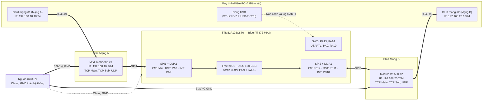
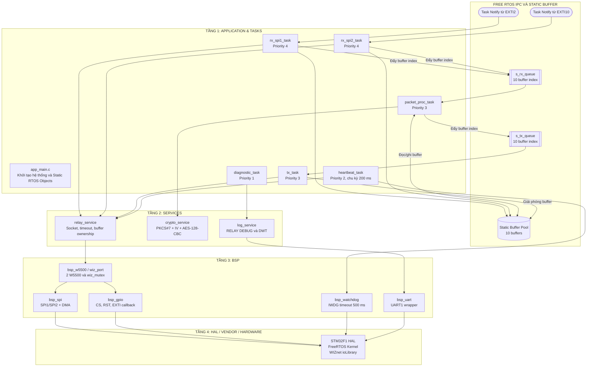

# Sơ đồ khối phần cứng



## Lý do thiết kế

- Dùng nguồn 3.3 V rời cho hai W5500 vì khi cả hai truyền/nhận, dòng tổng có thể khoảng 300–350 mA.
- Dùng SPI1 và SPI2 riêng để tách Mạng A và Mạng B ở mức phần cứng.
- Toàn bộ hệ thống phải dùng chung GND.
## Kiến trúc phần mềm, FreeRTOS và bộ nhớ

Phần mềm tuân thủ luồng phân lớp một chiều:

```text
Application & Tasks → Services → BSP → STM32 HAL / Vendor
```



### Luồng ownership của buffer

```text
FREE → RX task → RX queue → packet processing → TX queue → TX task → FREE
```

Queue chỉ chuyển `uint8_t buffer_idx`, không copy toàn bộ payload. Điều này giảm RAM, giảm tải CPU và xác định rõ task đang sở hữu buffer.

### Ước tính SRAM

| Thành phần | Ước tính |
|---|---:|
| 6 task ứng dụng, stack và TCB | 6,672 B |
| Idle task và Timer task | ~1,200 B |
| Static Buffer Pool | 5,600 B |
| Queue, mutex, AES context, HAL | ~2,200 B |
| Main/ISR stack | 1,536 B |
| **Tổng** | **~17,208 B / 20 KB (~86%)** |
| **Còn lại** | **~3,272 B** |

> Toàn bộ task, queue, mutex và buffer sử dụng cấp phát tĩnh. Cần bật `configCHECK_FOR_STACK_OVERFLOW = 2` và theo dõi `uxTaskGetStackHighWaterMark()` khi kiểm thử tải cao.
