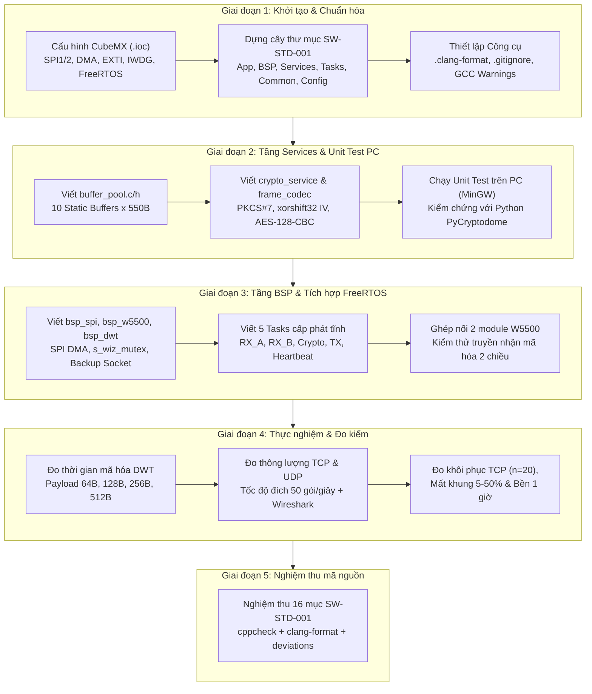
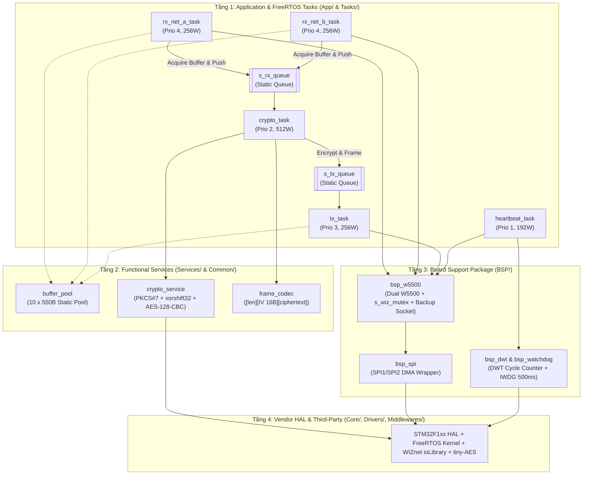

# Secure Gateway AES-128-CBC (STM32 & FreeRTOS)

Hệ thống cổng kết nối mã hóa hai chiều dữ liệu mạng qua TCP/UDP sử dụng STM32F103 và 2 chip W5500.

---

## 1. Sơ đồ khối Lộ trình triển khai (Project Workflow)

---

## 2. Sơ đồ khối Kiến trúc phân lớp & Luồng dữ liệu (System Architecture)

