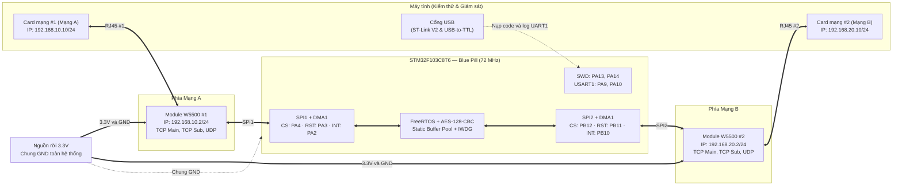

# Sơ đồ khối phần cứng

## Lý do thiết kế

- Dùng nguồn 3.3 V rời cho hai W5500 vì khi cả hai truyền/nhận, dòng tổng có thể khoảng 300–350 mA.
- Dùng SPI1 và SPI2 riêng để tách Mạng A và Mạng B ở mức phần cứng.
- Toàn bộ hệ thống phải dùng chung GND.
graph TB
    subgraph L1 ["TẦNG 1: APPLICATION & TASKS (App/ & Tasks/)"]
        APP["app_main.c Khởi tạo hệ thống & Static RTOS Objects"]
        T_RX1["rx_spi1_task (Priority: 4)"]
        T_RX2["rx_spi2_task (Priority: 4)"]
        T_PROC["packet_proc_task (Priority: 3)"]
        T_TX["tx_task (Priority: 3)"]
        T_HB["heartbeat_task (Priority: 2 - Chu kỳ 200ms)"]
        T_DIAG["diagnostic_task (Priority: 1)"]
    end

    subgraph IPC ["CƠ CHẾ ĐỒNG BỘ & HÀNG ĐỢI TĨNH (FreeRTOS Native IPC)"]
        NOTIFY1(["Task Notify (EXTI2)"])
        NOTIFY2(["Task Notify (EXTI10)"])
        Q_RX[["s_rx_queue (10 phần tử - Truyền buffer_index)"]]
        Q_TX[["s_tx_queue (10 phần tử - Truyền buffer_index)"]]
        POOL[("Static Buffer Pool 10 x 550 Bytes")]
    end

    subgraph L2 ["TẦNG 2: SERVICES (Services/)"]
        S_RELAY["relay_service Quản lý 3 Sockets/Chip, Timeout 5000ms, Đóng gói khung & Static Buffer Pool"]
        S_CRYPTO["crypto_service PKCS#7 Padding + xorshift32 IV + AES-128-CBC (tiny-AES)"]
        S_LOG["log_service Xuất log RELAY DEBUG & Đo chu kỳ DWT"]
    end

    subgraph L3 ["TẦNG 3: BOARD SUPPORT PACKAGE (BSP/)"]
        B_W5500["bsp_w5500 (wiz_port) Đa hợp 2 chip W5500 + s_wiz_mutex"]
        B_SPI["bsp_spi SPI1/SPI2 + DMA1 Transmit/Receive"]
        B_GPIO["bsp_gpio CS, RST, EXTI Callbacks"]
        B_WDG["bsp_watchdog IWDG (Timeout 500ms)"]
        B_UART["bsp_uart UART1 Wrapper"]
    end

    subgraph L4 ["TẦNG 4: VENDOR / HAL / HARDWARE (Core/, Drivers/, Middlewares/)"]
        HAL["STM32F1xx HAL + FreeRTOS Kernel + WIZnet ioLibrary"]
    end

    NOTIFY1 --> T_RX1
    NOTIFY2 --> T_RX2
    T_RX1 -->|"Cấp phát & Ghi bản rõ"| POOL
    T_RX2 -->|"Cấp phát & Ghi bản rõ"| POOL
    T_RX1 -->|"Đẩy index"| Q_RX
    T_RX2 -->|"Đẩy index"| Q_RX
    Q_RX --> T_PROC
    T_PROC <-->|"Đọc bản rõ / Ghi bản mã"| POOL
    T_PROC --> S_CRYPTO
    T_PROC -->|"Đẩy index"| Q_TX
    Q_TX --> T_TX
    T_TX -->|"Đọc bản mã & Giải phóng"| POOL

    T_RX1 & T_RX2 & T_TX & T_HB --> S_RELAY
    T_HB --> B_WDG
    T_DIAG --> S_LOG

    S_RELAY --> B_W5500
    B_W5500 --> B_SPI & B_GPIO
    S_LOG --> B_UART
    B_SPI & B_GPIO & B_WDG & B_UART --> HAL
