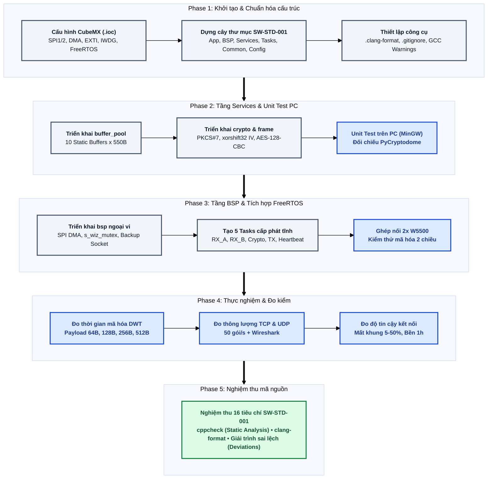
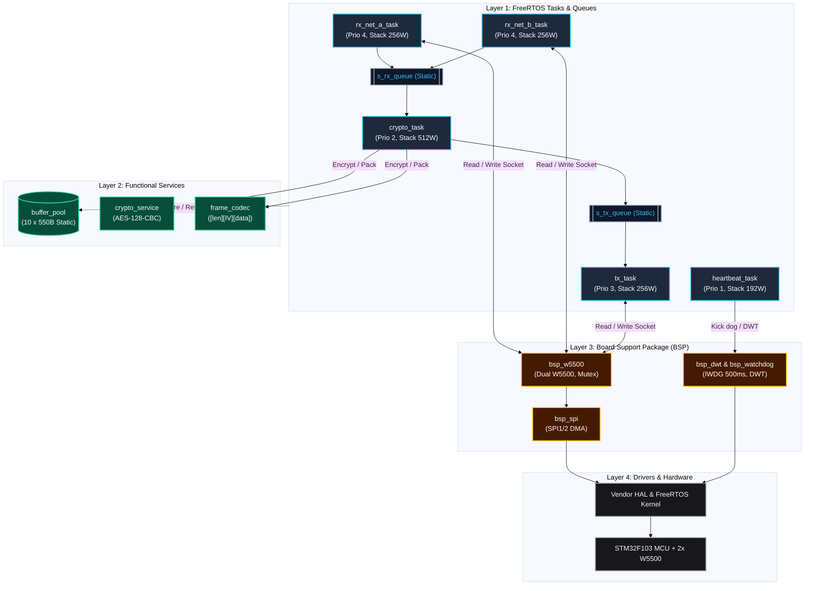

# Secure Gateway Project

## 1. Development Workflow

Quy trình phát triển và hoàn thiện hệ thống gồm 5 giai đoạn tuần tự: chuẩn hóa cấu trúc, kiểm thử dịch vụ trên PC, tích hợp BSP & FreeRTOS, đo kiểm thực nghiệm và nghiệm thu mã nguồn.



---

## 2. System Architecture

Kiến trúc hệ thống được phân lớp nghiêm ngặt, sử dụng 100% bộ nhớ tĩnh và giao tiếp luồng dữ liệu an toàn qua hàng đợi FreeRTOS giữa 2 giao diện mạng W5500.



---

## 3. Project Structure

Cấu trúc cây thư mục:

```text
├── App/                                  # Tầng ứng dụng cấp cao và điểm khởi chạy hệ thống
│   ├── app_main.c                        # Khởi tạo các static queue, task và phân phối tài nguyên
│   └── app_main.h                        # Interface điểm vào (entry point) của ứng dụng FreeRTOS
├── BSP/                                  # Board Support Package - Quản lý phần cứng ngoại vi
│   ├── bsp_dwt.c                         # Đo thời gian thực thi cấp chu kỳ xung nhịp CPU (DWT Cycle Counter)
│   ├── bsp_dwt.h                         # Interface đếm chu kỳ DWT phục vụ đo benchmark mã hóa
│   ├── bsp_spi.c                         # Driver SPI1/SPI2 chế độ DMA truyền nhận tốc độ cao
│   ├── bsp_spi.h                         # Interface điều khiển và ngắt DMA cho các kênh SPI
│   ├── bsp_w5500.c                       # Driver 2 chip W5500, socket dự phòng và s_wiz_mutex
│   ├── bsp_w5500.h                       # Interface khởi tạo socket và truyền nhận gói tin Ethernet
│   ├── bsp_watchdog.c                    # Driver phần cứng Independent Watchdog (IWDG chu kỳ 500ms)
│   └── bsp_watchdog.h                    # Interface làm mới watchdog (kick dog) định kỳ
├── Common/                               # Thư viện dùng chung, kiểu dữ liệu chuẩn và cấu hình tĩnh
│   ├── app_config.h                      # Định nghĩa kích thước buffer, độ dài queue, timeout
│   └── app_types.h                       # Định nghĩa kiểu dữ liệu chuẩn, cấu trúc bản tin và mã lỗi
├── Config/                               # File cấu hình hạt nhân hệ điều hành thời gian thực
│   └── FreeRTOSConfig.h                  # Cấu hình tiền định FreeRTOS: cấp phát tĩnh, tick rate, heap 0
├── Core/                                 # Mã nguồn khởi tạo vi điều khiển do STM32CubeMX tự sinh
│   ├── Inc/                              # Thư mục chứa header khởi tạo clock và ngoại vi STM32
│   └── Src/                              # Thư mục chứa main.c và cấu hình vector ngắt stm32f1xx_it.c
├── Drivers/                              # Thư viện driver phần cứng từ nhà sản xuất (ST)
│   ├── CMSIS/                            # Thư viện định nghĩa nhân ARM Cortex-M3 và thanh ghi
│   └── STM32F1xx_HAL_Driver/             # Thư viện ngoại vi STM32F1 HAL (SPI, GPIO, DMA, IWDG)
├── Middlewares/                          # Thư viện trung gian và phần mềm bên thứ ba
│   ├── FreeRTOS/                         # Mã nguồn nhân FreeRTOS Kernel (chế độ Static Allocation)
│   ├── tiny-AES/                         # Thư viện mã hóa AES-128-CBC tối ưu RAM/Flash cho vi điều khiển
│   └── WIZnet/                           # Bộ thư viện ioLibrary điều khiển chip mạng W5500
├── Services/                             # Tầng dịch vụ xử lý dữ liệu nghiệp vụ (Business Logic)
│   ├── buffer_pool.c                     # Quản lý 10 buffer tĩnh x 550B, cấp phát an toàn chống phân mảnh
│   ├── buffer_pool.h                     # Interface acquire/release buffer tĩnh an toàn đa luồng
│   ├── crypto_service.c                  # Thuật toán đệm PKCS#7, sinh IV xorshift32 và AES-128-CBC
│   ├── crypto_service.h                  # Interface dịch vụ mã hóa/giải mã dữ liệu
│   ├── frame_codec.c                     # Đóng gói và bóc tách cấu trúc khung tin [len][IV 16B][ciphertext]
│   └── frame_codec.h                     # Interface bộ mã hóa/giải mã khung truyền thông
├── Tasks/                                # Các tác vụ FreeRTOS độc lập (100% cấp phát tĩnh)
│   ├── crypto_task.c                     # Task xử lý mã hóa/giải mã dữ liệu (Prio 2, Stack 512W)
│   ├── crypto_task.h                     # Interface và hàm khởi tạo tĩnh crypto_task
│   ├── heartbeat_task.c                  # Task giám sát sống còn hệ thống & làm mới IWDG (Prio 1, Stack 192W)
│   ├── heartbeat_task.h                  # Interface và hàm khởi tạo tĩnh heartbeat_task
│   ├── rx_net_a_task.c                   # Task nhận dữ liệu từ giao diện mạng A (Prio 4, Stack 256W)
│   ├── rx_net_a_task.h                   # Interface và hàm khởi tạo tĩnh rx_net_a_task
│   ├── rx_net_b_task.c                   # Task nhận dữ liệu từ giao diện mạng B (Prio 4, Stack 256W)
│   ├── rx_net_b_task.h                   # Interface và hàm khởi tạo tĩnh rx_net_b_task
│   ├── tx_task.c                         # Task truyền khung tin ra giao diện mạng đích (Prio 3, Stack 256W)
│   └── tx_task.h                         # Interface và hàm khởi tạo tĩnh tx_task
├── tests/                                # Môi trường và kịch bản kiểm thử tự động
│   ├── pc_unit_tests/                    # Bộ Unit Test chạy trên PC (MinGW) kiểm thử logic Services
│   └── verify_pycryptodome.py            # Script Python đối chiếu tính đúng đắn với PyCryptodome
├── .clang-format                         # Tệp quy tắc định dạng code tuân thủ chuẩn SW-STD-001
├── .gitignore                            # Cấu hình loại trừ file build tạm (.o, .d) và workspace IDE
└── SecureGateway.ioc                     # Tệp cấu hình chân, clock, DMA, SPI trong STM32CubeMX
```
