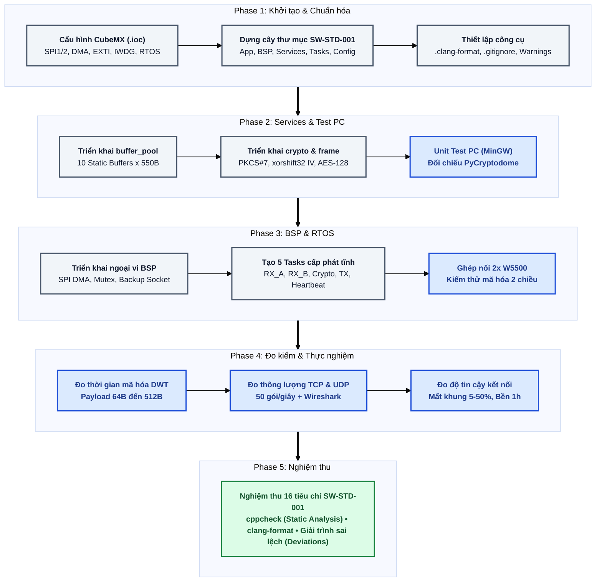

# Secure Gateway Project

## 1. Development Workflow

Quy trình phát triển và hoàn thiện hệ thống gồm 5 giai đoạn tuần tự: chuẩn hóa cấu trúc, kiểm thử dịch vụ trên PC, tích hợp BSP & FreeRTOS, đo kiểm thực nghiệm và nghiệm thu mã nguồn.



---

## 2. System Architecture

Kiến trúc hệ thống được phân lớp nghiêm ngặt, sử dụng 100% bộ nhớ tĩnh và giao tiếp luồng dữ liệu an toàn qua hàng đợi FreeRTOS giữa 2 giao diện mạng W5500.

```mermaid
%%{init: {'theme': 'base', 'themeVariables': { 'fontSize': '14px', 'fontFamily': 'ui-sans-serif, system-ui, Segoe UI, Roboto, sans-serif' }}}%%
flowchart TB
    classDef default font-size:13px;
    classDef taskClass    fill:#1E293B,stroke:#38BDF8,stroke-width:2px,color:#F8FAFC;
    classDef queueClass   fill:#0F172A,stroke:#38BDF8,stroke-width:2px,stroke-dasharray: 4 4,color:#38BDF8;
    classDef serviceClass fill:#064E3B,stroke:#34D399,stroke-width:2px,color:#F0FDF4;
    classDef bspClass     fill:#451A03,stroke:#FBBF24,stroke-width:2px,color:#FFFBEB;
    classDef hwClass      fill:#18181B,stroke:#94A3B8,stroke-width:2px,color:#F4F4F5;

    subgraph L1[" Layer 1: FreeRTOS Tasks & Queues "]
        direction TB
        subgraph Pipeline[" Pipeline truyền nhận và mã hóa/giải mã hai chiều "]
            direction LR
            RX["<b>rx_net_a / b_task</b><br/>(Prio 4, 256W)"]
            QRX[["<b>s_rx_queue</b><br/>(Static)"]]
            CRYPTO["<b>crypto_task</b><br/>(Prio 3, 512W)"]
            QTX[["<b>s_tx_queue</b><br/>(Static)"]]
            TX["<b>tx_task</b><br/>(Prio 3, 256W)"]

            RX --> QRX --> CRYPTO --> QTX --> TX
        end
        HB["<b>heartbeat_task</b><br/>(Prio 1, Stack 192W)"]
    end

    subgraph L2[" Layer 2: Functional Services "]
        direction LR
        POOL[("<b>buffer_pool</b><br/>10 x 550B Static")]
        CS["<b>crypto_service</b><br/>PKCS#7, AES-128-CBC"]
        CODEC["<b>frame_codec</b><br/>[len][IV 16B][ciphertext]"]
    end

    subgraph L3[" Layer 3: Board Support Package (BSP) "]
        direction LR
        WIZ["<b>bsp_w5500</b><br/>Dual W5500 & Mutex"]
        SPI["<b>bsp_spi</b><br/>SPI1/2 DMA Engine"]
        DIAG["<b>bsp_watchdog & dwt</b><br/>IWDG 500ms & DWT"]

        WIZ --> SPI
    end

    subgraph L4[" Layer 4: Drivers & Hardware "]
        direction LR
        HAL["<b>STM32F1 HAL & CMSIS</b>"]
        HW["<b>STM32F103 MCU + 2x W5500 Modules</b>"]

        HAL --> HW
    end

    CRYPTO -->|"Mã hóa/Giải mã"| CS
    CRYPTO -->|"Đóng/Tách khung"| CODEC
    RX & CRYPTO & TX -.->|"Xin & Trả Buffer"| POOL
    RX <--|"Đọc gói tin"| WIZ
    TX -->|"Ghi gói tin"| WIZ
    HB -->|"Giám sát & Kick IWDG"| DIAG
    SPI & DIAG --> HAL

    class RX,CRYPTO,TX,HB taskClass;
    class QRX,QTX queueClass;
    class POOL,CS,CODEC serviceClass;
    class WIZ,SPI,DIAG bspClass;
    class HAL,HW hwClass;
```

---

## 3. Project Structure

Cấu trúc cây thư mục:

```text
├── App/                        # Điểm khởi chạy ứng dụng FreeRTOS
│   ├── app_main.c              # Khởi tạo queue, task và điều phối hệ thống
│   └── app_main.h              # Interface điểm vào của app
├── BSP/                        # Board Support Package - Ngoại vi MCU
│   ├── bsp_dwt.c               # Đếm chu kỳ CPU (DWT) đo benchmark mã hóa
│   ├── bsp_dwt.h               # Interface DWT Cycle Counter
│   ├── bsp_spi.c               # Driver SPI1/SPI2 chế độ DMA non-blocking
│   ├── bsp_spi.h               # Interface điều khiển SPI DMA
│   ├── bsp_w5500.c             # Driver 2x W5500, socket dự phòng & mutex
│   ├── bsp_w5500.h             # Interface truyền nhận Ethernet W5500
│   ├── bsp_watchdog.c          # Driver Independent Watchdog (IWDG 500ms)
│   └── bsp_watchdog.h          # Interface làm mới (kick) watchdog
├── Common/                     # Thư viện dùng chung & cấu hình tĩnh
│   ├── app_config.h            # Kích thước buffer, độ dài queue, timeout
│   └── app_types.h             # Định nghĩa struct bản tin và mã lỗi
├── Config/                     # Cấu hình hạt nhân RTOS
│   └── FreeRTOSConfig.h        # Cấu hình Static Allocation, tick rate
├── Core/                       # Mã khởi tạo do STM32CubeMX tự sinh
│   ├── Inc/                    # Header khởi tạo clock & ngoại vi
│   └── Src/                    # main.c và vector ngắt stm32f1xx_it.c
├── Drivers/                    # Driver phần cứng từ nhà sản xuất (ST)
│   ├── CMSIS/                  # Nhân ARM Cortex-M3 và thanh ghi
│   └── STM32F1xx_HAL_Driver/   # Thư viện ngoại vi STM32F1 HAL
├── Middlewares/                # Thư viện trung gian bên thứ ba
│   ├── FreeRTOS/               # Nhân FreeRTOS (Static Allocation)
│   ├── tiny-AES/               # Thư viện AES-128-CBC tối ưu MCU
│   └── WIZnet/                 # Bộ thư viện ioLibrary cho W5500
├── Services/                   # Dịch vụ xử lý dữ liệu nghiệp vụ
│   ├── buffer_pool.c           # Quản lý 10 buffer tĩnh x 550B an toàn
│   ├── buffer_pool.h           # Interface acquire/release static buffer
│   ├── crypto_service.c        # PKCS#7 padding, xorshift32 IV & AES-128
│   ├── crypto_service.h        # Interface mã hóa/giải mã
│   ├── frame_codec.c           # Đóng/tách gói [len][IV 16B][ciphertext]
│   └── frame_codec.h           # Interface đóng/tách khung truyền thông
├── Tasks/                      # Các tác vụ FreeRTOS (100% cấp phát tĩnh)
│   ├── crypto_task.c           # Task mã hóa dữ liệu (Prio 2, Stk 512W)
│   ├── crypto_task.h           # Interface crypto_task
│   ├── heartbeat_task.c        # Task giám sát & kick IWDG (Prio 1, Stk 192W)
│   ├── heartbeat_task.h        # Interface heartbeat_task
│   ├── rx_net_a_task.c         # Task nhận mạng A (Prio 4, Stk 256W)
│   ├── rx_net_a_task.h         # Interface rx_net_a_task
│   ├── rx_net_b_task.c         # Task nhận mạng B (Prio 4, Stk 256W)
│   ├── rx_net_b_task.h         # Interface rx_net_b_task
│   ├── tx_task.c               # Task truyền mạng (Prio 3, Stk 256W)
│   └── tx_task.h               # Interface tx_task
├── tests/                      # Kiểm thử tự động trên PC
│   ├── pc_unit_tests/          # Bộ Unit Test trên PC (MinGW)
│   └── verify_pycryptodome.py  # Script Python đối chiếu PyCryptodome
├── .clang-format               # Quy tắc định dạng chuẩn SW-STD-001
├── .gitignore                  # Bỏ qua file build tạm và file IDE
└── SecureGateway.ioc           # File cấu hình STM32CubeMX
```
