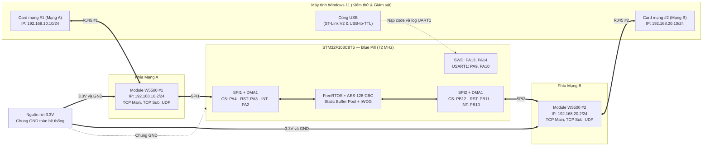

# Sơ đồ khối phần cứng

## Lý do thiết kế

- Dùng nguồn 3.3 V rời cho hai W5500 vì khi cả hai truyền/nhận, dòng tổng có thể khoảng 300–350 mA.
- Dùng SPI1 và SPI2 riêng để tách Mạng A và Mạng B ở mức phần cứng.
- Toàn bộ hệ thống phải dùng chung GND.
